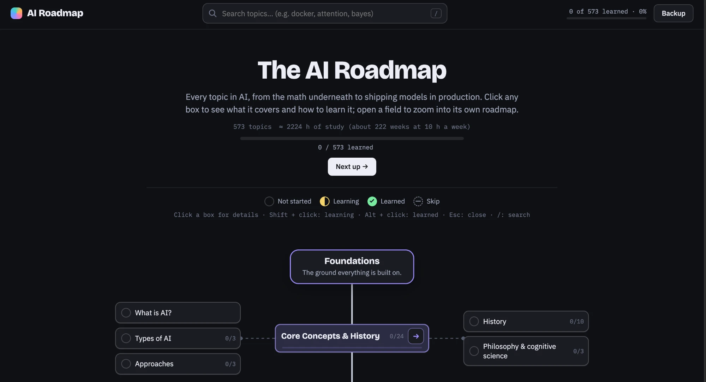

# AI Roadmap



An interactive 2D roadmap of artificial intelligence: 18 fields and 573 topics, from the math
underneath to shipping models in production. Inspired by the roadmap.sh style.

- **Roadmaps you can zoom into.** The home roadmap shows every field with its main topics.
  Open a field (→) to get its own roadmap, and keep going: any box with subtopics has one.
- **Details for every topic.** Click a box to open a drawer with a plain-words explanation,
  what you need to learn (subtopics or a checklist), a rough study-time estimate and
  a four-step plan for how to learn it: intuition, curated free resources, a practice idea
  and a self-check.
- **Track your progress.** Mark topics as *Learning*, *Learned* or *Skip*
  (Shift + click: learning, Alt + click: learned). Progress bars update everywhere.
- **Notes and search.** Per-topic notes that save automatically; search with `/`.
- **Backup.** Progress lives in `localStorage`; export/import it as JSON. Backups from
  [AI Learning Tree](https://github.com/FurkanSamli/ai-learning-tree) load too (same topic ids).

Plain HTML, CSS and ES modules. No build step, no dependencies.

## Running it

```bash
npm run dev            # with Node  → http://localhost:5174
# or
python3 -m http.server 5174
```

Open http://localhost:5174. A local server is needed because browsers do not load modules and
content files from `file://`.

Check the content with `npm run check`.

## Project layout

- `src/` code (module map in `CLAUDE.md`)
- `content/*.txt` topics, one file per field (format in `docs/CONTENT_FORMAT.md`)
- `content/resources.json` curated free resources and practice ideas
- `scripts/check-content.mjs` content checker
