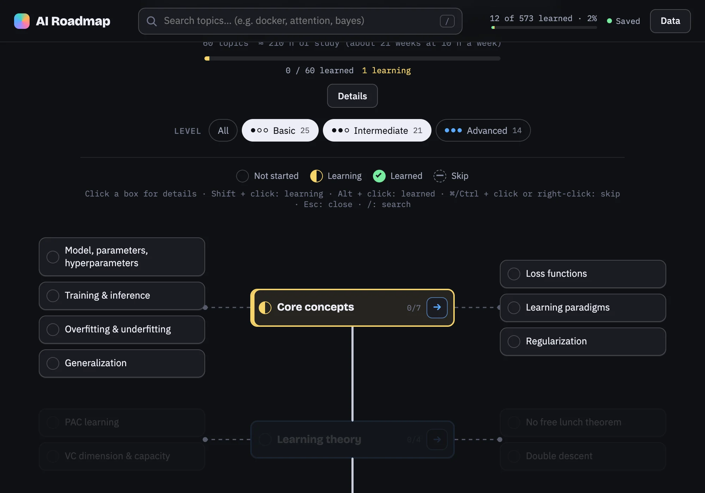
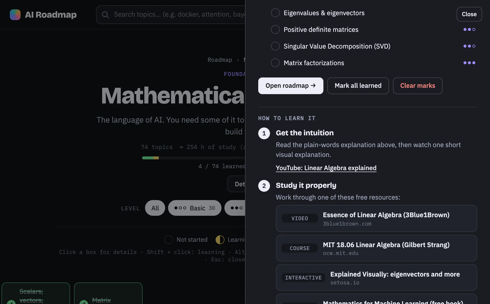

# AI Roadmap


An interactive 2D roadmap of artificial intelligence: 18 fields and 573 topics, from the math
underneath to shipping models in production. Inspired by the roadmap.sh style.

- **Roadmaps you can zoom into.** The home roadmap shows every field with its main topics.
  Open a field (→) to get its own roadmap, and keep going: any box with subtopics has one.
- **Details for every topic.** Click a box to open a drawer with a plain-words explanation,
  what you need to learn (subtopics or a checklist), a rough study-time estimate and
  a four-step plan for how to learn it: intuition, curated free resources, a practice idea
  and a self-check.
- **Track your progress.** Mark topics as *Learning*, *Learned* or *Skip*
  (Shift + click: learning, Alt + click: learned, ⌘/Ctrl + click or right-click: skip;
  the same shortcut again sets it back). Progress bars update everywhere.
- **Filter by level.** Show *Basic*, *Intermediate* and/or *Advanced* topics, in any
  combination. It only changes the view: other topics fade out, nothing else changes.


- **Notes and search.** Per-topic notes that save automatically; search with `/`.
- **Saved to a local database.** Progress is saved automatically to a SQLite file in the
  project folder (see below). Export/import as JSON from **Data**; files from
  [AI Learning Tree](https://github.com/FurkanSamli/ai-learning-tree) load too (same topic ids).



Plain HTML, CSS and ES modules, plus a small Node server for saving progress. No build step, no dependencies.

## Running it

You need [Node.js](https://nodejs.org/) 18 or newer. From the project folder:

```bash
npm run dev
```

Then open http://localhost:5174. There is nothing to install: `server.mjs` uses only what
ships with Node.

## Where your progress is saved

`npm run dev` starts a small local server that serves the site **and saves your progress in a
SQLite database inside the project**: `data/progress.db`. It saves automatically after every
change; the badge in the top bar shows *Saved*, *Saving…* or *Not saved*.

- Nothing leaves your computer. The server only listens on `localhost`, and `data/` is in
  `.gitignore`, so your progress is never committed.
- Progress you already had in the browser moves into the database the first time you run it.
- Node 22.13+ uses its built-in SQLite. Older Node versions fall back to `data/progress.json`.
- Want the same progress on two computers? Keep the data in a synced folder:
  `DATA_DIR=~/Dropbox/ai-roadmap npm run dev`. Use `PORT=8080 npm run dev` for another port.
- **Data** in the top bar exports everything as a JSON file and imports it again.

Without Node, `python3 -m http.server 5174` works too, but then progress is only kept in the
browser's `localStorage`.

Check the content with `npm run check`.

## Database

| Table | Contents |
| --- | --- |
| `status` | status per topic (1 learning, 2 known/learned, 3 skipped) and when it changed |
| `notes` | your note per topic |
| `checks` | ticked checklist items (AI Roadmap) |
| `status_log` | every status change with a timestamp, for a future progress chart |
| `meta` | small settings (e.g. whether the intro was shown) |

You can open it with any SQLite tool, e.g. `sqlite3 data/progress.db "select * from status_log"`.

## Project layout

- `src/` code (module map in `CLAUDE.md`)
- `content/*.txt` topics, one file per field (format in `docs/CONTENT_FORMAT.md`)
- `content/resources.json` curated free resources and practice ideas
- `server.mjs` local server and progress database
- `scripts/check-content.mjs` content checker
